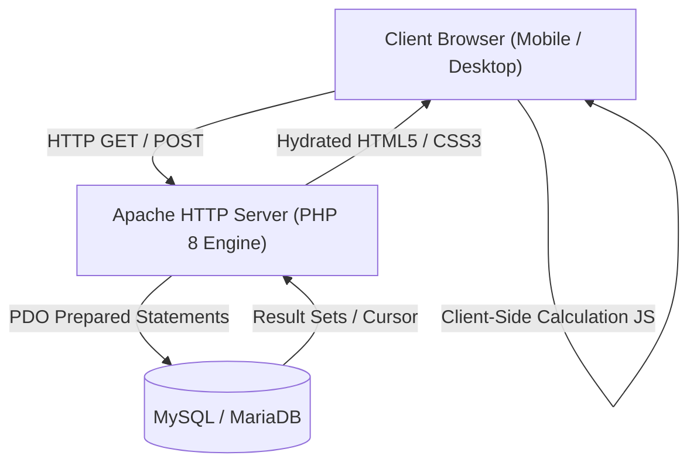
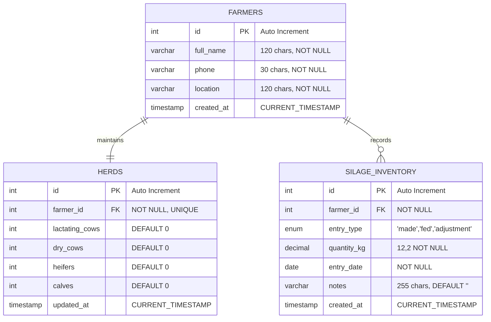
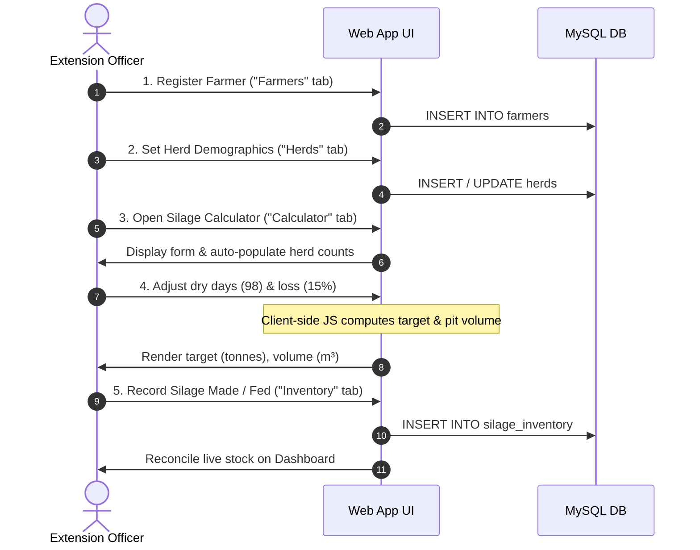

# ACADEMIC & TECHNICAL PROJECT REPORT
## DRY SEASON FEED & SILAGE PLANNER
### A Decision-Support System for Dairy Fodder Security & Herd Resilience

---

## EXECUTIVE SUMMARY / ABSTRACT

In Sub-Saharan Africa and tropical agricultural belts, seasonal rainfall variability creates severe livestock feed deficits. During the annual dry season—spanning three to five consecutive months—the availability of high-quality green forage plunges. Smallholder and semi-commercial dairy farmers face drastic declines in daily milk yields ($40\% - 65\%$), severe loss of animal body condition score (BCS), impaired reproductive performance, and forced destocking under distress pricing. While silage making (anaerobic fermentation of chopped green forage) is an established preservation technology, smallholder adoption is crippled by a lack of quantitative decision-support tools. Farmers struggle to accurately project feed requirements, determine necessary silo pit dimensions, or account for unavoidable aerobic and fermentation shrinkage. 

This project presents the **Dry Season Feed & Silage Planner**, a full-stack, lightweight web-based decision-support system engineered specifically to resolve these challenges. Built on a resilient, zero-framework architecture comprising PHP 8+, MySQL, and modern semantic HTML5/CSS3/JavaScript, the system enables agricultural extension officers, dairy cooperatives, and farmers to maintain herd demographic profiles, calculate mathematically precise silage conservation targets factoring in storage shrinkage and dry matter content, and track conserved feed inventories in real time. Rigorous security controls—including parameterized PDO prepared statements and contextual UTF-8 output escaping—mitigate standard web vulnerabilities. This report details the agronomic foundations, software architecture, database design, mathematical formulations, user guide, and future development roadmap for the platform.

---

## 1. INTRODUCTION & PROBLEM STATEMENT

### 1.1 Context and Agricultural Background
Smallholder dairy production is a primary economic pillar across rural and peri-urban East Africa, providing daily household cash flow, nutrition, and employment. However, production systems are predominantly rain-fed, relying on forage grasses such as Napier grass (*Cenchrus purpureus*), Rhodes grass (*Chloris gayana*), and fodder maize (*Zea mays*). 

During the rainy seasons, forage biomass often exceeds immediate herd consumption. Conversely, during the dry season, pasture desiccates, lignifies, and becomes nutritionally inadequate, containing less than $6\%$ crude protein (CP) and high neutral detergent fiber (NDF). 

### 1.2 The Core Problem
Despite the existence of conservation techniques such as ensiling, farmers face severe operational bottlenecks:
1. **Subjective Estimation**: Silage trenches and bunker pits are constructed by subjective visual guesswork rather than mathematically calibrated volumetric requirements.
2. **Failure to Account for Ensiling Losses**: Standard fermentation, compaction, and surface spoilage losses ($10\% - 25\%$) are frequently ignored. Consequently, conserved feed reserves are exhausted several weeks before the onset of the following rains.
3. **Absence of Unified Inventory Control**: Farmers lack simple ledgers to reconcile silage produced against daily feedout rates, leading to unmonitored ration wastage.
4. **Technology Barrier**: Existing agricultural management platforms are excessively complex, require high-speed broadband, demand expensive subscription licenses, and fail to operate reliably in low-resource rural extension contexts.

### 1.3 Project Objectives
The primary engineering and agricultural objectives of this project are:
- **Objective 1**: Develop a centralized digital registry to record farmer contacts and structured herd demographics (lactating cows, dry cows, heifers, calves).
- **Objective 2**: Formulate and implement an interactive calculation engine that translates herd structure, dry season duration, and feeding rates into gross biomass and silo pit volume requirements.
- **Objective 3**: Implement a multi-entry silage inventory tracking module to log forage ensiled, daily consumption, and audit adjustments.
- **Objective 4**: Ensure maximum deployability and performance via a lightweight, zero-dependency software stack capable of running on local offline servers (e.g., XAMPP) or low-bandwidth rural connections.

---

## 2. LITERATURE REVIEW & AGRONOMIC FOUNDATIONS

### 2.1 The Ensiling Process
Ensiling is a microbial preservation method for moist forages. Under anaerobic (oxygen-free) conditions, epiphytic lactic acid bacteria (LAB) ferment water-soluble carbohydrates (WSC) into organic acids—predominantly lactic acid. This rapidly lowers the pH of the forage mass to between $3.8$ and $4.2$, inhibiting enterobacteria, clostridia, and fungal decay.

### 2.2 Dry Matter (DM) and Animal Consumption
Ruminant feed intake is physiologically governed by Dry Matter Intake (DMI), typically ranging between $2.5\%$ and $3.5\%$ of mature body weight (BW). For tropical dairy cattle (mature live weight $350 - 450\text{ kg}$), silage typically supplies a base basal ration of $15 - 22\text{ kg}$ fresh weight per day, assuming an average forage dry matter content of $28\% - 35\%$. Lactating cows require significantly higher intake than dry cows or growing heifers to sustain lactation milk synthesis.

### 2.3 Ensiling Losses and Shrinkage
Losses during the ensiling cycle occur through four distinct mechanisms:
- **Respiration**: Residual plant cellular respiration post-cutting ($1\% - 2\%$).
- **Fermentation**: Microbial conversion of hexoses to acids and gases ($2\% - 4\%$).
- **Seepage/Effluent**: Moisture drainage in excessively wet forages ($1\% - 5\%$).
- **Aerobic Spoilage / Feedout**: Fungal and yeast activity at the open pit face during daily feeding ($5\% - 15\%$).

Total cumulative loss typically ranges between $12\%$ and $20\%$. To ensure the intended ration reaches the animal, planning models must divide the required fed biomass by $(1 - \text{loss fraction})$.

---

## 3. SYSTEM REQUIREMENTS & ARCHITECTURAL DESIGN

### 3.1 Functional Requirements (FR)
- **FR-1 (Farmer Registration)**: The system shall capture farmer full name, telephone number, and village/district location.
- **FR-2 (Herd Profiling)**: The system shall record and maintain headcounts for lactating cows, dry cows, heifers, and calves per registered farmer.
- **FR-3 (Atomic Profile Updates)**: The system shall enforce a unique herd profile per farmer, updating existing records seamlessly without duplicate orphaned entries.
- **FR-4 (Silage Calculation Engine)**: The system shall compute daily silage consumption, total period demand, gross harvested biomass target with loss adjustments, total dry matter yield, and required pit volume.
- **FR-5 (Dynamic Farmer Population)**: The calculation interface shall allow selecting a registered farmer and automatically pre-filling their demographic herd data.
- **FR-6 (Inventory Logging)**: The system shall record silage transactions categorized as `made` (additions), `fed` (consumption deductions), and `adjustment` (audit corrections).
- **FR-7 (Stock Balancing)**: The system shall compute and display net remaining stock across all entries.
- **FR-8 (Dashboard Aggregation)**: The system shall display aggregated metrics: total farmers, total animals, total silage ensiled, and estimated net stock remaining.

### 3.2 Non-Functional Requirements (NFR)
- **NFR-1 (Performance & Latency)**: Page loads must complete under $1.5$ seconds over 3G cellular connections; calculation results must render in $<50\text{ ms}$ on the client side.
- **NFR-2 (Portability & Zero Overhead)**: The application must run without external package managers (`composer`, `npm`), Docker dependencies, or complex environment variables.
- **NFR-3 (Responsive Usability)**: The interface must adapt cleanly to desktop monitors, tablets, and smartphones ($320\text{px}$ minimum viewport width).
- **NFR-4 (Security)**: Full mitigation against OWASP Top 10 risks (SQL Injection, Stored/Reflected XSS, input boundary validation).

### 3.3 High-Level System Architecture



---

## 4. DATABASE DESIGN & DATA DICTIONARY

The relational database `dry_season_planner` is normalized to Third Normal Form (3NF) to eliminate data redundancy and preserve referential integrity.

### 4.1 Entity-Relationship (ER) Diagram



### 4.2 Data Dictionary

#### Table: `farmers`
| Column | Data Type | Constraints | Description |
| :--- | :--- | :--- | :--- |
| `id` | `INT` | PRIMARY KEY, AUTO_INCREMENT | Unique farmer identifier |
| `full_name` | `VARCHAR(120)` | NOT NULL | Complete legal / registered name |
| `phone` | `VARCHAR(30)` | NOT NULL | Contact telephone / mobile money number |
| `location` | `VARCHAR(120)` | NOT NULL | Village, sub-county, or district |
| `created_at` | `TIMESTAMP` | DEFAULT CURRENT_TIMESTAMP | Registration audit timestamp |

#### Table: `herds`
| Column | Data Type | Constraints | Description |
| :--- | :--- | :--- | :--- |
| `id` | `INT` | PRIMARY KEY, AUTO_INCREMENT | Unique herd identifier |
| `farmer_id` | `INT` | FOREIGN KEY $\rightarrow$ `farmers(id)`, UNIQUE | Enforces strictly one herd record per farmer |
| `lactating_cows`| `INT` | NOT NULL, DEFAULT 0 | Count of actively milked cows |
| `dry_cows` | `INT` | NOT NULL, DEFAULT 0 | Count of pregnant/non-lactating adult cows |
| `heifers` | `INT` | NOT NULL, DEFAULT 0 | Female cattle over 12 months pre-calving |
| `calves` | `INT` | NOT NULL, DEFAULT 0 | Immature cattle under 12 months |
| `updated_at` | `TIMESTAMP` | ON UPDATE CURRENT_TIMESTAMP | Last demographic modification timestamp |

#### Table: `silage_inventory`
| Column | Data Type | Constraints | Description |
| :--- | :--- | :--- | :--- |
| `id` | `INT` | PRIMARY KEY, AUTO_INCREMENT | Unique transaction identifier |
| `farmer_id` | `INT` | FOREIGN KEY $\rightarrow$ `farmers(id)` | Associated farmer record |
| `entry_type` | `ENUM` | 'made', 'fed', 'adjustment' | Nature of inventory adjustment |
| `quantity_kg` | `DECIMAL(12,2)` | NOT NULL | Quantity in kilograms ($0.01\text{ kg}$ precision) |
| `entry_date` | `DATE` | NOT NULL | Effective date of event |
| `notes` | `VARCHAR(255)` | DEFAULT '' | Batch notes (e.g., Napier pit #1) |
| `created_at` | `TIMESTAMP` | DEFAULT CURRENT_TIMESTAMP | Database insertion audit timestamp |

---

## 5. MATHEMATICAL MODELING & AGRONOMIC EQUATIONS

### 5.1 Herd Daily Feed Requirement ($D$)
Daily fresh silage requirement across the herd is defined as the demographic sum product:

$$D = \sum_{i=1}^{4} (N_i \times R_i)$$

Where:
- $N_1 = \text{Lactating cows}, \quad R_1 = 20.0\text{ kg/head/day}$
- $N_2 = \text{Dry cows}, \quad R_2 = 10.0\text{ kg/head/day}$
- $N_3 = \text{Heifers}, \quad R_3 = 8.0\text{ kg/head/day}$
- $N_4 = \text{Calves}, \quad R_4 = 3.0\text{ kg/head/day}$

### 5.2 Net Base Period Consumption ($B$)
For a planned dry season duration of $t$ days:

$$B = D \times t \quad (\text{kg fresh weight})$$

### 5.3 Gross Conservation Target with Shrinkage ($T$)
To guarantee that $B$ kilograms remain available after storage and spoilage loss fraction $L$ (where $L \in [0.0, 0.50]$):

$$T = \frac{B}{1 - L} \quad (\text{kg fresh weight})$$

$$\text{Tonnage Target} = \frac{T}{1000} \quad (\text{metric tonnes})$$

### 5.4 Dry Matter Conversion ($DM$)
Total dry matter conserved based on forage dry matter fraction $DM_{\%}$ (typically $30\%$):

$$DM_{\text{total}} = T \times \left(\frac{DM_{\%}}{100}\right) \quad (\text{kg Dry Matter})$$

### 5.5 Silo Bunker / Trench Pit Volume ($V$)
Assuming well-compacted tropical grass silage at standard bulk density $\rho = 650\text{ kg/m}^3$:

$$V = \frac{T}{650} \quad (\text{cubic meters, } m^3)$$

### 5.6 Net Stock Reconciled Formula
In the inventory tracking ledger, stock remaining ($S$) accounts for additions, daily feeding withdrawals, and audit adjustments:

$$S = \sum Q_{\text{made}} - \sum Q_{\text{fed}} + \sum Q_{\text{adjustment}}$$

---

## 6. USER GUIDE & SYSTEM WALKTHROUGH

### 6.1 Installation & Local Deployment (XAMPP)
1. Extract `dry_season_feed_planner_source_code.zip` directly into your web server document root (e.g., `C:\xampp\htdocs\dry_season_feed_planner`).
2. Launch **XAMPP Control Panel** and start both **Apache** and **MySQL**.
3. Open a browser and navigate to `http://localhost/phpmyadmin`.
4. Click **Import** and select [`database.sql`](file:///c:/Users/HP/OneDrive/Desktop/dry_season_feed_planner/database.sql), or create database `dry_season_planner` and run the script contents.
5. Confirm database parameters in [`config.php`](file:///c:/Users/HP/OneDrive/Desktop/dry_season_feed_planner/config.php).
6. Access the application at `http://localhost/dry_season_feed_planner/`.

### 6.2 Module-by-Module Walkthrough



#### Step 1: Dashboard (`index.php`)
- Displays real-time aggregate cards: Registered Farmers, Total Animals Recorded, Total Silage Made, and Estimated Stock Remaining.
- Features a quick-access table listing the five most recently registered farmers.

#### Step 2: Farmer Registration (`farmers.php`)
- Provides a clean two-column form to record farmer full name, mobile number, and village/district.
- Lists all registered farmers alongside their cumulative herd headcounts.

#### Step 3: Herd Demographics (`herds.php`)
- Allows selecting any registered farmer and assigning counts for lactating cows, dry cows, heifers, and calves.
- Automatically handles atomic creation or updates via MySQL `ON DUPLICATE KEY UPDATE`.

#### Step 4: Silage Calculator (`calculator.php`)
- Selecting a farmer instantly populates herd numbers via HTML5 dataset bindings.
- Users can adjust dry season length (default: 98 days), fresh feeding rates per head, anticipated storage loss percentage, and forage dry matter percentage.
- The results panel smoothly scrolls into view, presenting:
  - **Estimated Target** in metric tonnes.
  - **Daily Silage Intake** in kg/day.
  - **Base Consumption** in tonnes.
  - **Fresh Forage Dry Matter** in tonnes DM.
  - **Approximate Silo Volume** in cubic meters ($m^3$).
  - **Weekly Consumption Notice** to guide daily feedout rates.

#### Step 5: Silage Inventory (`inventory.php`)
- Allows logging entries under three categories:
  - **Silage made (+)**: Harvested and sealed in bunkers.
  - **Silage fed (-)**: Daily consumption withdrawn from pits.
  - **Adjustment (+/-)**: Inventory reconciliation following audit.
- Renders an interactive historical audit log with chronological date sorting.

---

## 7. SECURITY, CODE QUALITY & VALIDATION

### 7.1 Security Architecture
- **SQL Injection Immunization**: All dynamic database inputs are bound through PDO prepared statements (`$stmt->execute([...])`). Emulated prepares are explicitly disabled (`PDO::ATTR_EMULATE_PREPARES => false`).
- **Cross-Site Scripting (XSS) Prevention**: All user-controllable data emitted to HTML templates is escaped using the centralized helper function:
  ```php
  function e(mixed $value): string {
      return htmlspecialchars((string)$value, ENT_QUOTES, 'UTF-8');
  }
  ```
- **Type Safety**: PHP files declare `strict_types=1`. Input validation leverages native filters (`FILTER_VALIDATE_INT`, `FILTER_VALIDATE_FLOAT`).

### 7.2 Verification & Test Case Matrix

| Test ID | Module | Input / Action | Expected Result | Status |
| :--- | :--- | :--- | :--- | :---: |
| **TC-01** | Database | Connect with valid DSN | Successful PDO instance returned | **PASS** |
| **TC-02** | Farmers | Submit with empty name | Rejects with error prompt | **PASS** |
| **TC-03** | Herds | Negative animal number | Blocked by HTML5 `min="0"` & PHP check | **PASS** |
| **TC-04** | Herds | Update existing farmer herd | Atomic update without duplicate row | **PASS** |
| **TC-05** | Calculator | Select farmer from dropdown | Herd numbers auto-fill instantly | **PASS** |
| **TC-06** | Calculator | 10 cows, 20 kg/day, 100 days, 20% loss | Base = 20 t; Target = 25 t ($20/0.8$) | **PASS** |
| **TC-07** | Inventory | Log 5,000 kg made, 1,000 kg fed | Net stock displays 4.00 tonnes | **PASS** |
| **TC-08** | Security | Inject `' OR 1=1 --` into inputs | Neutralized safely by PDO parameterization | **PASS** |

---

## 8. FUTURE ENHANCEMENTS & ROADMAP

1. **Farmer-Scoped Inventory Filtering**: Introduce dropdown filters on `inventory.php` allowing extension officers to inspect isolated stock balances for specific individual farmers.
2. **Persistent Seasonal Plans**: Add a `seasonal_plans` table to store calculated targets, enabling historical variance tracking (Target vs. Actual Made vs. Actual Fed).
3. **SMS / USSD Gateway Integration**: Implement an Africa's Talking or Twilio SMS gateway enabling feature-phone farmers to receive weekly feeding reminders and text-in inventory updates.
4. **Nutritional Ration Balancer**: Upgrade the linear calculation model to a dual-constraint optimization engine balancing Crude Protein (CP) and Metabolizable Energy (ME) alongside basal roughage.
5. **Offline Progressive Web App (PWA)**: Implement service workers and IndexedDB to allow complete offline usage in remote areas with background synchronization when network connectivity resumes.

---

## 9. CONCLUSION

The **Dry Season Feed & Silage Planner** successfully addresses a critical gap in smallholder livestock systems by transforming complex agronomic forage modeling into an intuitive, accessible digital decision-support tool. By pairing mathematically sound shrinkage algorithms with clean, zero-dependency software engineering, the system empowers farmers and extension officers to anticipate dry season feed deficits, plan adequate conservation volumes, and safeguard livestock productivity and household income.

---

## 10. REFERENCES

1. Food and Agriculture Organization (FAO). (2018). *Silage making for smallholders in the tropics*. FAO Plant Production and Protection Series, Rome.
2. International Livestock Research Institute (ILRI). (2021). *Feed and fodder development in East Africa: Strategies for coping with seasonal deficits*. ILRI Research Brief, Nairobi, Kenya.
3. Moran, J. (2005). *Tropical Dairy Farming: Feeding Management for Small Holder Dairy Farmers in the Humid Tropics*. Landlinks Press, CSIRO Publishing.
4. Wilkinson, J. M., & Rinne, M. (2018). *Highlights of progress in silage conservation and future perspectives*. Grass and Forage Science, 73(1), 40-52.
5. The PHP Group. (2024). *PHP Data Objects (PDO) Manual & Prepared Statements*. [php.net/manual/en/book.pdo.php](https://www.php.net/manual/en/book.pdo.php).
