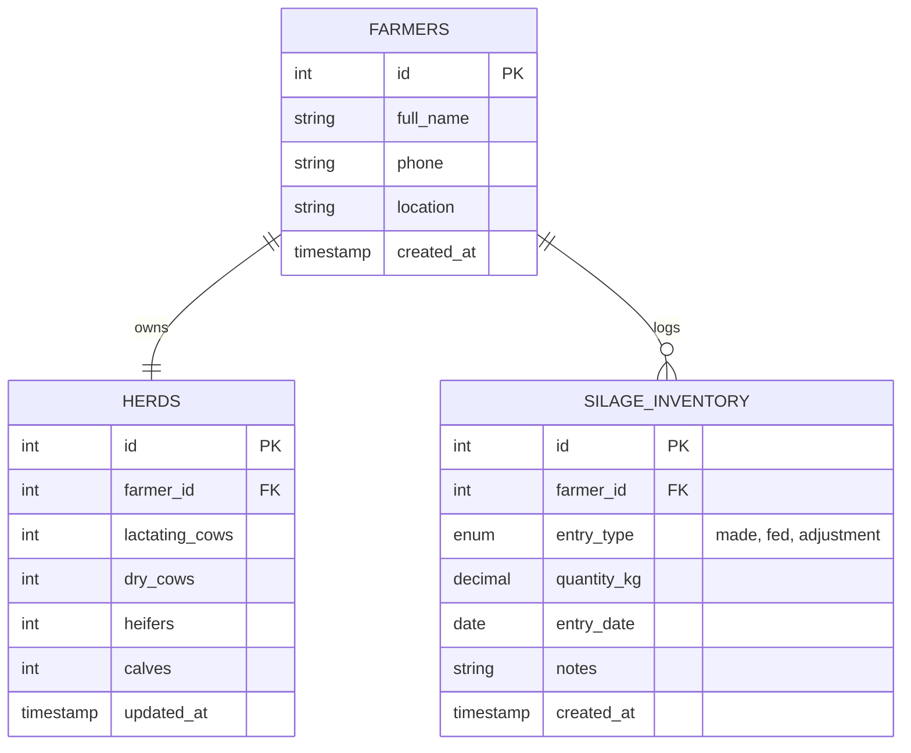

# 📊 Project Presentation Slides Outline
## Dry Season Feed & Silage Planner
**A Decision-Support Web Application for Smallholder & Commercial Dairy Farmers**

---

## Slide 1: Title Slide

### Visual Layout
- **Header / Brand**: 🌱 Feed & Silage Planner
- **Main Title**: Dry Season Feed & Silage Planner
- **Subtitle**: Optimizing Fodder Conservation & Dairy Herd Survival Through Seasonal Decision Support
- **Presenter / Student Name**: Phanuel Niyonkuru
- **Institution / Course**: Final Project Presentation
- **Repository**: [github.com/niyonkuruphanuel6-source/dry_season_feed_planner](https://github.com/niyonkuruphanuel6-source/dry_season_feed_planner)

### Speaker Notes
> "Good morning/afternoon, esteemed lecturer and colleagues. Today, I am proud to present the **Dry Season Feed and Silage Planner**—a lightweight, practical decision-support web application engineered to bridge the critical feed deficit that dairy farmers face during prolonged dry seasons."

---

## Slide 2: The Problem Context

### Slide Content
- **The Dry Season Dairy Crisis**:
  - In tropical and semi-arid dairy regions, green forage availability drops drastically during dry spells (90–120 days).
  - Lack of feed leads to a **40% to 65% drop in daily milk production**.
  - Severe weight loss, delayed reproduction cycles, and forced distress selling of livestock at loss-making prices.
- **The Root Cause**:
  - Farmers do not lack grass during rainy seasons; they lack **quantitative planning tools** to estimate how much fodder they must harvest, ensile, and store before the dry season hits.
  - Feeding decisions are made by subjective guesswork rather than herd-calibrated calculations.

### Speaker Notes
> "Every year, livestock farmers experience devastating losses not because forage doesn't grow, but because they have no data-driven way to plan ahead. When the rains stop, pasture dries up within weeks. Without quantitative planning, farmers run out of silage midway through the dry season, resulting in collapsed milk income and malnourished herds."

---

## Slide 3: The Proposed Solution

### Slide Content
- **Dry Season Feed & Silage Planner**:
  - A specialized, web-based digital tool connecting **Herd Demographics**, **Agronomic Silage Requirements**, and **Real-Time Stock Inventory**.
- **Three Pillar Approach**:
  1. **Profile**: Register farmers and maintain precise herd structures (lactating cows, dry cows, heifers, calves).
  2. **Predict**: Calculate accurate gross fresh silage targets factoring in storage shrinkage, dry matter, and pit capacity.
  3. **Preserve & Monitor**: Track actual inventory (silage made, daily feeding deductions, and audit adjustments).

### Speaker Notes
> "Our solution solves this with three interconnected pillars: Profiling the farm herd, Predicting the exact tonnage of silage required to survive the dry period, and Monitoring conserved stock from pit opening to harvest end."

---

## Slide 4: System Architecture & Tech Stack

### Slide Content
- **Architecture Model**: Lightweight 3-Tier Web Architecture
- **Technology Choices**:
  - **Backend**: Native PHP 8.0+ with Strict Typing and PDO (`mysql:charset=utf8mb4`).
  - **Database**: MySQL / MariaDB relational database with cascading foreign keys (`ON DELETE CASCADE`).
  - **Frontend**: Zero-framework Vanilla HTML5 and CSS3 (CSS Grid & Flexbox, fully mobile-responsive).
  - **Client-Side Engine**: Vanilla JavaScript (ES6+) for instant, zero-reload calculations.
- **Why this Stack?**:
  - Zero heavy framework dependencies or build steps.
  - Sub-second load times on rural 2G/3G mobile networks.
  - Effortless local deployment on XAMPP for offline rural agricultural extension centers.

### Speaker Notes
> "From an engineering perspective, rural usability was our primary constraint. Rather than using heavy JavaScript or PHP frameworks with massive dependencies, we built a zero-dependency architecture using PHP 8 with PDO and modern CSS Grid. It loads instantly even on weak rural networks and runs out-of-the-box on local XAMPP setups."

---

## Slide 5: Database Design & Data Integrity

### Slide Content

- **Integrity Highlights**:
  - Unique 1-to-1 constraint between farmers and herds (`UNIQUE KEY uq_herd_farmer`).
  - Atomic upsert support via `ON DUPLICATE KEY UPDATE`.
  - Referential integrity with cascading deletes.

### Speaker Notes
> "Our database schema is cleanly normalized into third normal form. A unique key constraint ensures each farmer has exactly one active herd profile, updated atomically. Foreign key cascades guarantee that if a farmer record is deleted, associated herd and inventory records are cleanly purged without orphaned data."

---

## Slide 6: The Mathematical & Agronomic Engine

### Slide Content
1. **Daily Intake Model ($D$)**:
   $$D = (N_{\text{lactating}} \times R_{\text{lactating}}) + (N_{\text{dry}} \times R_{\text{dry}}) + (N_{\text{heifers}} \times R_{\text{heifers}}) + (N_{\text{calves}} \times R_{\text{calves}})$$
   *(Defaults: 20 kg for lactating cows, 10 kg for dry cows, 8 kg for heifers, 3 kg for calves)*

2. **Base Consumption ($B$)**:
   $$B = D \times \text{Days to Cover (e.g. 98 days)}$$

3. **Storage & Spoilage Shrinkage Target ($T$)**:
   $$T = \frac{B}{1 - (\text{Loss } \% / 100)}$$
   *Note: Using division correctly models original harvested biomass before fermentation and surface mold loss.*

4. **Silo Pit Storage Volume**:
   $$V = \frac{T}{650\text{ kg/m}^3} \quad (\text{Standard compacted tropical silage density})$$

### Speaker Notes
> "The heart of the application is our agronomic calculation model. We calculate base feed requirements across four herd demographics. Crucially, we incorporate a fermentation and spoilage shrinkage factor using inverse loss division. If a farmer expects 15% loss, dividing by 0.85 ensures they ensile enough green matter so that after shrinkage, the herd still gets 100% of its required ration."

---

## Slide 7: Live System Demonstration & Workflow

### Slide Content
- **Step 1: Dashboard Overview**
  - Instant executive visibility into registered farmers, total animal count, conserved silage, and available net stock.
- **Step 2: Register Farmer & Profile Herd**
  - Intuitive forms with input validation, preventing negative animal numbers or invalid phone inputs.
- **Step 3: Silage Calculator in Action**
  - Selecting a registered farmer auto-fills herd counts via HTML5 dataset bindings.
  - Interactive sliders and inputs allow adjusting dry season duration, loss percentages, and dry matter content.
  - Real-time calculation output displays target tonnage, daily feeding rate, and required silo pit volume in cubic meters ($m^3$).
- **Step 4: Stock Logging**
  - Record silage production batches (`made`), daily consumption (`fed`), or audit corrections (`adjustment`).

### Speaker Notes
> "Let us look at the user workflow. From the dashboard, an extension officer sees community-level feed stats. They register a farmer, profile their herd, and jump directly to the calculator. Selecting the farmer automatically pulls their herd demographics. The officer inputs the projected dry season length—say 90 days—and within milliseconds, the system produces the exact tonnage of silage to make and the pit volume required to dig."

---

## Slide 8: Security & Code Robustness

### Slide Content
- **OWASP Compliance & Defensive Programming**:
  - **SQL Injection Prevention**: $100\%$ parameterized PDO prepared statements throughout all database interactions.
  - **Cross-Site Scripting (XSS)**: Strict UTF-8 escaping via custom `e()` helper wrapping `htmlspecialchars(..., ENT_QUOTES, 'UTF-8')`.
  - **Data Hygiene**: PHP type hints (`declare(strict_types=1)`), strict integer and float filtering via `filter_input()`.
  - **Inventory Equation Correctness**:
    $$\text{Net Stock} = \sum (\text{Made}) - \sum (\text{Fed}) + \sum (\text{Adjustment})$$

### Speaker Notes
> "Security was built into the foundation. We completely eliminate SQL injection through PDO parameterized statements and protect against XSS using contextual output escaping. Furthermore, all data inputs undergo strict type casting and boundary checks, ensuring negative numbers or malformed dates cannot corrupt the calculations."

---

## Slide 9: Project Impact & Agronomic Benefits

### Slide Content
| Before Planner (Guesswork) | After Planner (Decision Support) |
| :--- | :--- |
| Silage pits dug by rough estimation | Precise cubic-meter pit dimensions calculated in advance |
| Feed runs out mid-season causing severe yield drops | Guaranteed herd maintenance through targeted conservation |
| Unaccounted ensiling losses (spoilage, mold) | Built-in $10\% - 25\%$ buffer prevents mid-season deficits |
| Paper logs prone to water/soil damage | Centralized, durable digital records for cooperatives |

### Speaker Notes
> "The real-world impact is significant. Instead of farmers guessing pit sizes or discovering in August that their silage ran out, cooperatives and extension agents can plan precise forage allocations in May. This prevents emergency destocking, stabilizes milk production year-round, and protects rural family livelihoods."

---

## Slide 10: Future Roadmap & Enhancements

### Slide Content
- **Phase 1: Multi-Tenant Authentication & Roles**
  - Role-Based Access Control (Admin, Extension Worker, Individual Farmer).
- **Phase 2: USSD & SMS Gateway Integration**
  - Enable feature-phone farmers without smartphones or computers to query stock and receive feeding alerts via SMS.
- **Phase 3: Nutrient & Balanced Ration Optimization**
  - Integrate Crude Protein (CP) and Metabolizable Energy (ME) calculations to complement basal roughage planning with concentrates.
- **Phase 4: Weather & Satellite Forecast Integration**
  - Automatically predict dry season onset and duration based on meteorological rainfall anomaly data.

### Speaker Notes
> "Looking forward, the architecture is primed for expansion. We plan to introduce SMS/USSD integration so farmers with basic feature phones can receive weekly feedout reminders. We will also incorporate full nutritional ration balancing (protein and energy) and link to satellite weather forecasts."

---

## Slide 11: Conclusion & Project Links

### Slide Content
- **Conclusion**:
  - The Dry Season Feed & Silage Planner provides an affordable, resilient, and scientifically grounded solution to seasonal livestock malnutrition.
  - Successfully deployed, verified, and source-controlled.
- **Project Resources**:
  - **GitHub Repository**: [github.com/niyonkuruphanuel6-source/dry_season_feed_planner](https://github.com/niyonkuruphanuel6-source/dry_season_feed_planner)
  - **Source Code**: Packaged archive available on Google Drive.
- **Thank you! Questions & Discussion**.

### Speaker Notes
> "In conclusion, this project demonstrates how clean software engineering and agronomic science can combine to solve real agricultural challenges in developing economies. Thank you for your time, and I welcome any questions."
